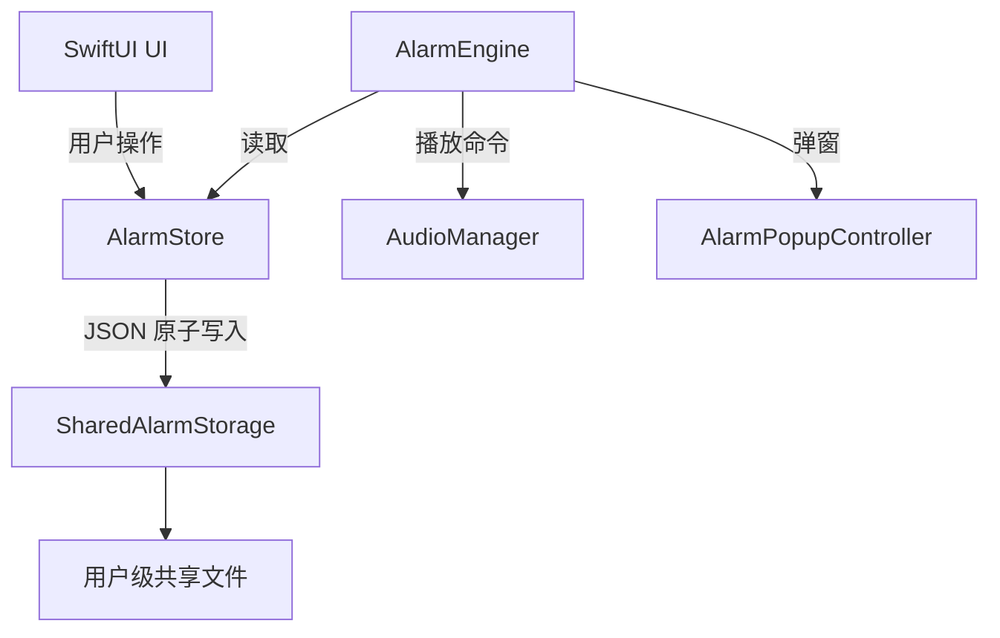

# Architecture

## 目标

Music Alarm 的核心可靠性来自三个边界：数据存储、闹钟调度和播放控制。UI 只负责编辑状态，不能自己决定是否触发闹钟。

## 当前模块

```text
AppDelegate
├── AlarmStore
│   └── SharedAlarmStorage
│   └── AlarmOccurrence history
├── AudioManager
├── AlarmEngine
├── AppSettings
├── SingleInstanceGuard
└── SwiftUI views
    ├── ContentView
    ├── AddAlarmView
    ├── AlarmRowView
    └── AlarmPopupView
```

### `AlarmStore`

- 持有闹钟列表和导入音频库。
- 负责旧 UserDefaults 数据迁移。
- 负责编辑、启停、贪睡和持久化。
- 负责全局暂停和单个闹钟临时禁用，并将全局暂停截止时间写入共享 `runtime.json`。
- 不再把应用容器目录作为唯一数据源。

### `SharedAlarmStorage`

- 固定使用用户级 `Application Support/Music Alarm` 目录。
- 使用 JSON 原子写入，避免读到半个文件。
- 在每个 JSON 文件旁保留 `.bak` 最近一次有效副本。
- 主文件损坏时优先恢复备份；主文件和备份都损坏时保留现状，不把空数组写回磁盘。
- 将导入音频复制到共享 `Audio/` 目录。

### `AlarmEngine`

使用具体 occurrence/deadline 判断到期，并让 Timer 只等待最近的 deadline。应用启动、重新激活、系统唤醒和系统时间变化时会重新计算 deadline，并按设置补偿近期错过的 occurrence。多个同时到期的闹钟进入队列。一次性闹钟只有在播放或 fallback 成功开始后才会被消费。

当闹钟开启起床确认时，播放开始后状态变为 pending；停止声音会变为 stoppedWithoutConfirmation；用户确认后变为 confirmed。一次性闹钟只有 confirmed 才会关闭。

每次播放成功或失败都会写入一个 `AlarmOccurrence`；失败时会消费当前 occurrence
并结束弹窗，避免损坏音频或不可用的系统 fallback 让引擎永久停留在 ringing 状态。

每个闹钟保存播放渐入、目标音量、最大播放时长和播放列表是否循环。测试闹钟使用同一套播放和弹窗路径，但不会修改持久化闹钟状态。

起床确认由 `AppSettings` 全局开启，再由单个闹钟选择是否要求确认。确认期限和方式也由设置控制，时间戳保存在闹钟记录中。

### `AudioManager`

负责本地文件预览、闹钟播放、渐入和系统 fallback。播放失败会返回给调度器，由调度器尝试下一个音频。完成回调会检查当前播放器身份，避免旧回调推进新的播放状态。

当播放列表不循环并且最后一首完成时，`AlarmEngine` 走统一的 stop/finish 路径，确保音频、弹窗、最大播放计时器和候选队列同时清理。

全局暂停和单个闹钟临时禁用会在候选生成、最近 deadline 计算和播放队列开始前同时检查，
因此暂停期间不会产生新的 occurrence。暂停截止后，重新激活、存储变化或定时器会让调度器
重新计算下一次 deadline。

### 主题与动态视觉

`AppThemePalette` 将每个主题拆成背景、surface、文字、accent、警告、危险和成功颜色。
`Dawn Flow` 使用橙、红、紫和蓝紫色缓慢流动，适合作为应用的品牌视觉；`Dracula`、`Nord`
和 `Catppuccin` 保留各自开源配色的层级关系。`ThemeBackdrop` 根据空闲、即将响铃、暂停、
正在响铃和等待确认状态切换颜色，并在用户启用减少动画时停止持续旋转。

### Diagnostics and verification

Settings exposes the current clock, time zone, UTC offset, daylight-saving
state, next scheduler deadline, and last scheduler event. The repository also
contains a repeatable core smoke test and an optional macOS accessibility UI
smoke test. The core test checks storage recovery, backup restore, occurrence
history, audio-library health, localization parity, and required accessibility
labels.

### 应用生命周期

- `SingleInstanceGuard` 使用用户级锁文件保证同一用户只运行一个 Music Alarm 进程。
- 从另一个目录打开的副本会激活已有进程并退出，避免两个调度器同时播放同一个 occurrence。
- `AppSettings` 保存登录启动、启动隐藏和菜单栏显示选项。
- 登录启动使用 macOS 13 及以上的 `SMAppService`；较旧系统保留用户设置并显示兼容行为。

## 数据流



## 多副本一致性

应用启动时读取共享文件。应用再次激活时会重新加载共享文件，因此同一台 Mac 上从其他应用副本修改闹钟后，当前副本回到前台可以看到最新列表。写入使用临时文件替换，避免其他副本读到截断 JSON。

当前通过单实例约束避免两个运行中的调度器重复响铃，`SharedAlarmStorage` 也会在写入 JSON 前获取跨进程锁。JSON 存储仍不提供两个文件之间的崩溃事务；后续如果需要更强的一致性，应引入 SQLite/事务日志。

## 版本与验证

每个阶段使用独立版本号并提交、推送，但开发阶段不创建 GitHub Release。2.18.0 的核心验证
包括共享暂停状态、临时禁用、runtime 备份恢复、主题编译、多语言 parity 和无障碍 smoke test。
