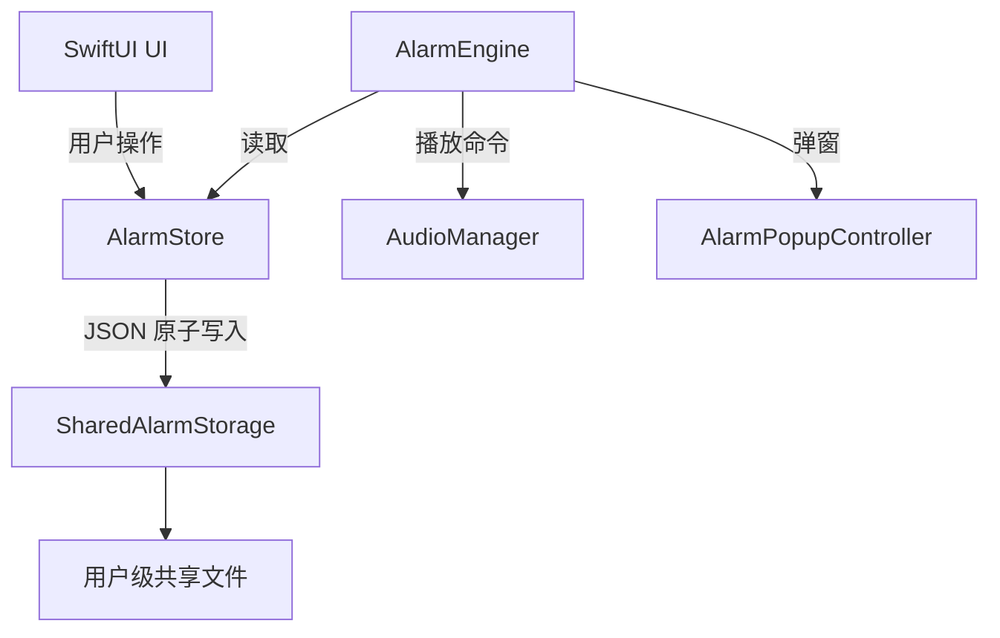

# Architecture

## 目标

Music Alarm 的核心可靠性来自三个边界：数据存储、闹钟调度和播放控制。UI 只负责编辑状态，不能自己决定是否触发闹钟。

## 当前模块

```text
AppDelegate
├── AlarmStore
│   └── SharedAlarmStorage
├── AudioManager
├── AlarmEngine
└── SwiftUI views
    ├── ContentView
    ├── AddAlarmView
    ├── AlarmRowView
    └── AlarmPopupView
```

### `AlarmStore`

- 持有闹钟列表和导入音频库。
- 负责旧 UserDefaults 数据迁移。
- 负责编辑、启停、贪睡和持久化。
- 不再把应用容器目录作为唯一数据源。

### `SharedAlarmStorage`

- 固定使用用户级 `Application Support/Music Alarm` 目录。
- 使用 JSON 原子写入，避免读到半个文件。
- 在每个 JSON 文件旁保留 `.bak` 最近一次有效副本。
- 主文件损坏时优先恢复备份；主文件和备份都损坏时保留现状，不把空数组写回磁盘。
- 将导入音频复制到共享 `Audio/` 目录。

### `AlarmEngine`

当前仍在重构中。现有实现的下一阶段会改为基于具体 occurrence/deadline 的调度，并处理系统睡眠、应用晚启动、同时到期和播放失败。

### `AudioManager`

负责本地文件预览、闹钟播放、渐入和系统 fallback。后续阶段会增加播放会话标识，防止旧播放器的完成回调推进新的播放状态。

## 数据流



## 多副本一致性

应用启动时读取共享文件。应用再次激活时会重新加载共享文件，因此同一台 Mac 上从其他应用副本修改闹钟后，当前副本回到前台可以看到最新列表。写入使用临时文件替换，避免其他副本读到截断 JSON。

这不是多进程事务数据库：如果两个副本在同一时刻修改同一个列表，最后成功写入的一方可能覆盖另一方。后续可以使用 `NSFileCoordinator` 或 SQLite/事务日志解决真正的并发编辑；当前阶段先保证跨路径、跨版本的单写者数据共享和崩溃恢复。

## 后续阶段

1. 可靠 occurrence 调度和播放状态机。
2. 删除 Spotify，迁移旧 Spotify 记录。
3. 可选“我已经真正起床”确认。
4. 音频库引用、失效文件和重复导入治理。
5. 签名、公证、CI 和发布脚本安全化。
